<!-- ================================================= -->
<!-- HECTOR ALVES | AI & MACHINE LEARNING PROFILE      -->
<!-- ================================================= -->

  

  

  
  

---

<h2 align="left"> TECH STACK</h2>

<!-- BACK-END & DEVELOPMENT -->

  

<!-- AI & DATA SCIENCE -->

  

<!-- AI ECOSYSTEM -->

  
  
  
  
  

---

<h2 align="left"> SOBRE MIM</h2>

  Olá! Sou <strong>Hector Renato</strong>, estudante de Inteligência Artificial e Machine Learning, interessado em entender como a tecnologia pode resolver problemas reais.

  Minha jornada na tecnologia passa pela programação, inteligência artificial e desenvolvimento de soluções. Tenho direcionado meus estudos para Python, Machine Learning, RAG e LLMs, buscando transformar o conhecimento adquirido em projetos práticos.

  Atualmente, meu objetivo é conquistar uma oportunidade de estágio em Inteligência Artificial, Machine Learning ou Desenvolvimento de Software, onde eu possa aprender, contribuir e evoluir profissionalmente.

  <i>Não quero apenas acompanhar a evolução da tecnologia. Quero participar dela.</i>

---

<h2 align="left">CONTATO</h2>

  
    Estou aberto a conexões, oportunidades profissionais e projetos
    na área de tecnologia e Inteligência Artificial.
  

  
  

---

<h2 align="left">EDUCAÇÃO</h2>

  <strong><big>Inteligência Artificial e Machine Learning</big></strong> 
  <big>Faculdade das Américas (FAM)</big> 
  Bacharelado · Em andamento

  <strong><big>Desenvolvimento Back-end em Python</big></strong> 
  <big>Alura</big> 
  Carreira em andamento

---

<h2 align="left"> PROJETOS</h2>

  <strong>Projects in Development</strong>

  Atualmente estou desenvolvendo meus conhecimentos em 
  Inteligência Artificial, Machine Learning e Back-end com Python. 
  Em breve, novos projetos estarão disponíveis por aqui!

  

---

  

